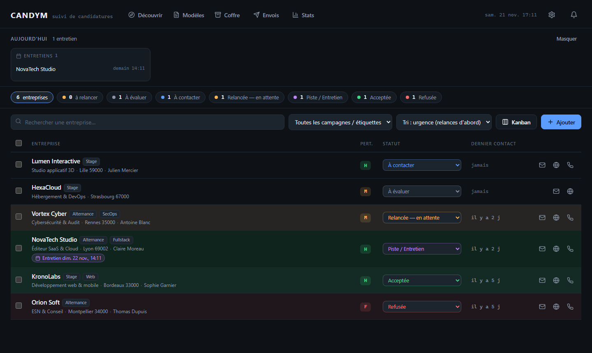

# Candym

Application locale de suivi de candidatures (**stages, alternances, emplois**).
Tout tourne en local sur votre machine (`127.0.0.1`) avec **Node.js (Express 5)** et **SQLite** (`node:sqlite`), sans compte cloud ni dépendance externe.



## Fonctionnalités

- **Suivi visuel** — Vue tableau ou Kanban par statut, tri par urgence, filtre par campagne/étiquette et panneau *Aujourd'hui* (entretiens, réponses reçues, relances à faire).
- **Prospection intégrée** — Recherche d'entreprises actives par secteur (API `data.gouv.fr`), offres et recruteurs (*La bonne alternance*), et raccourcis pré-remplis vers les principaux jobboards (+ sources personnalisables).
- **Envoi de candidatures** — Modèles de mails à variables dynamiques (`{entreprise}`, `{interlocuteur}`…), ouverture en brouillon (Gmail, Outlook, `mailto:`) ou **envoi direct SMTP** (immédiat ou programmé, avec pièces jointes).
- **Détection automatique des réponses (IMAP)** — Relève périodique de la boîte mail, rapprochement avec les entreprises suivies et classement automatique (*refus*, *piste*, *acceptation*) avec notifications Windows.
- **Coffre à documents** — Stockage local dédupliqué (CV, lettres, portfolio PDF) pour joindre ses fichiers en un clic.
- **Statistiques & sauvegardes** — Taux et délai de réponse, efficacité par modèle, export/import JSON & CSV, sauvegardes automatiques.

## Démarrage rapide

**Prérequis :** [Node.js](https://nodejs.org) ≥ 22.5 (Windows).

Sous Windows, double-cliquez sur **`start.bat`** (installe les dépendances au premier lancement, démarre le serveur et ouvre `http://localhost:3400`), ou en ligne de commande :

```bash
npm install
npm start      # http://localhost:3400
npm test       # suite de tests automatisés (node:test)
```

## Configuration (optionnelle)

Depuis le bouton **Réglages** (en haut à droite) :

- **Boîte mail (IMAP / SMTP)** : renseignez votre adresse et un mot de passe d'application ([Gmail](https://myaccount.google.com/apppasswords) / Outlook). Le secret est stocké dans le **Gestionnaire d'identifiants Windows**, jamais dans la base SQLite.
- **La bonne alternance** : collez un jeton *Production* créé sur [api.apprentissage.beta.gouv.fr](https://api.apprentissage.beta.gouv.fr) pour débloquer la recherche d'offres directement dans *Découvrir*.

## Documentation technique

L'architecture du projet, le modèle de sécurité, le fonctionnement du coffre, le détail de l'API REST/SSE et la suite de tests sont documentés dans **[ARCHITECTURE.md](ARCHITECTURE.md)**.
